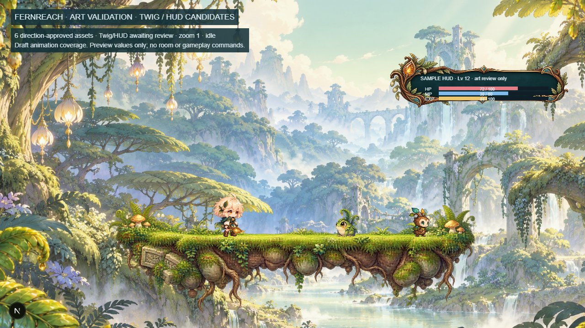
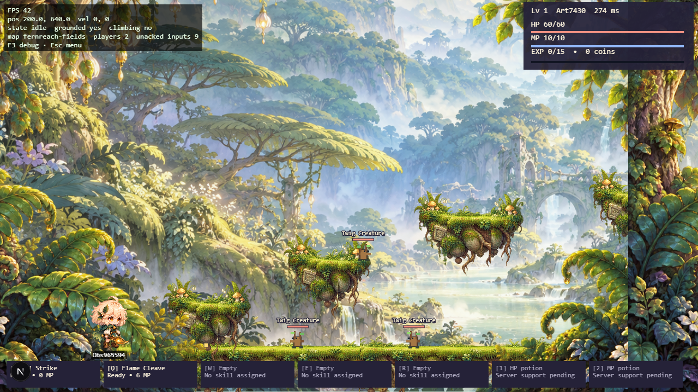
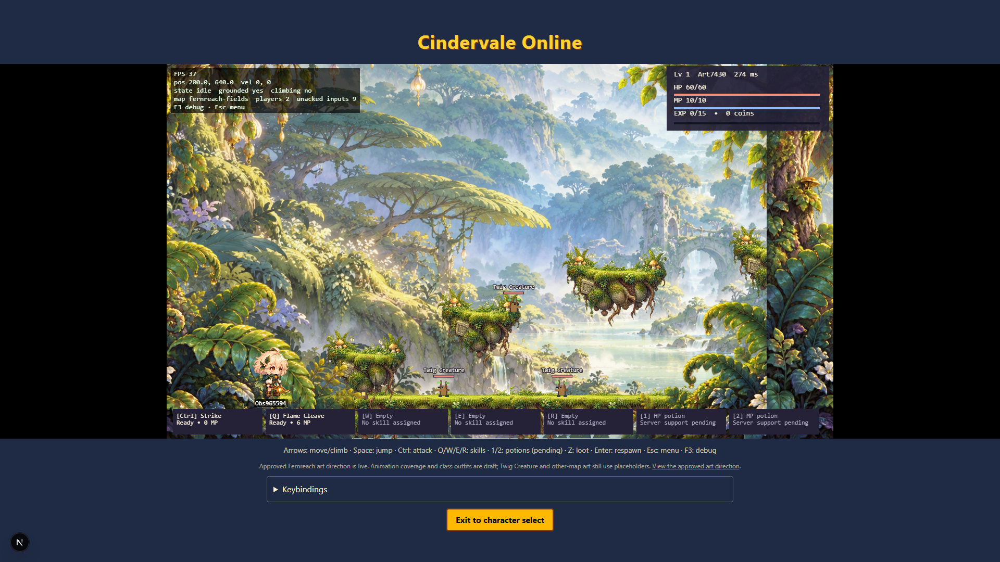
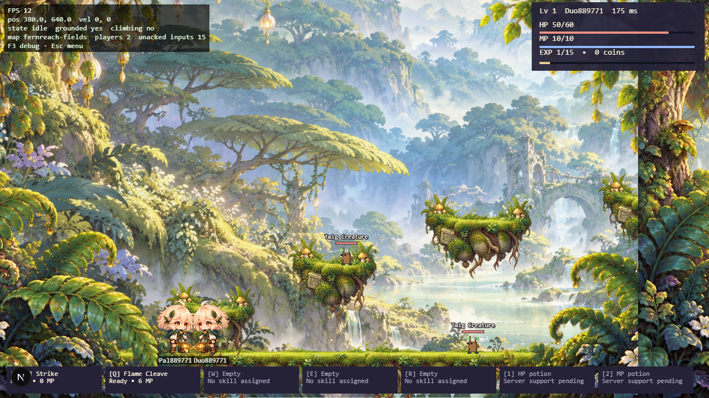
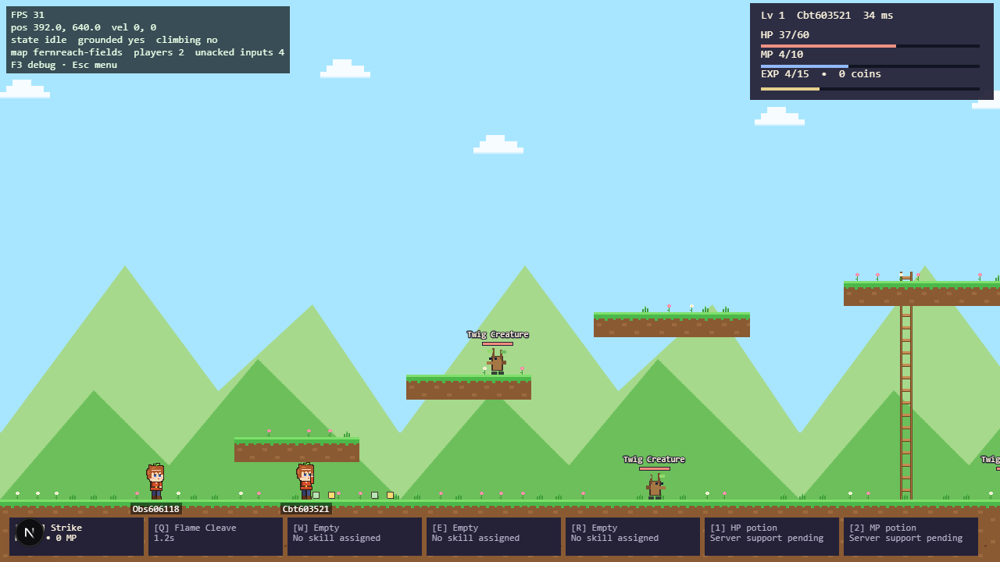
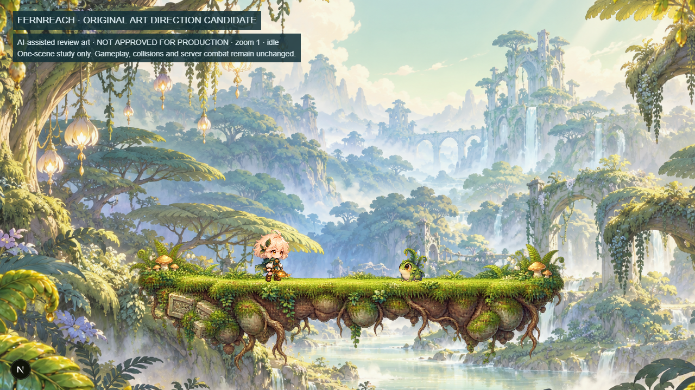
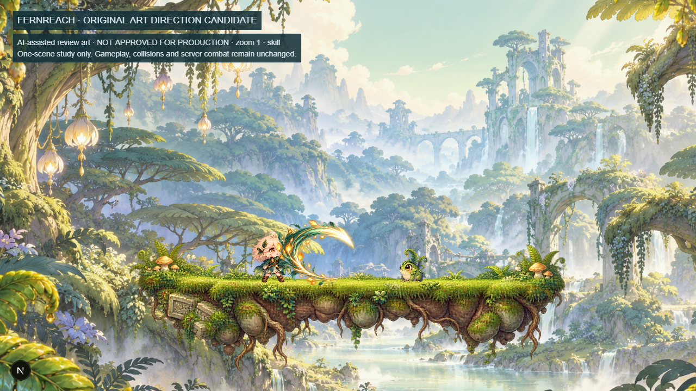
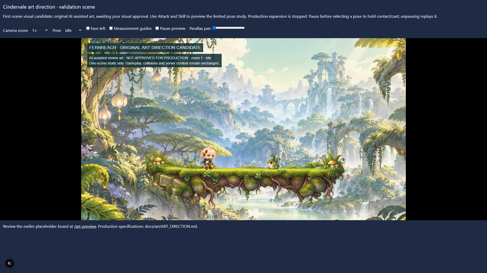

# Visual comparison and replacement plan

2026-10-21 · **Direction approved; first live Fernreach rollout**

The user approved the displayed visual direction on 2026-10-21 and identified the live game as the view requiring correction. Fernreach gameplay now uses the same six original reviewed textures: adventurer, Fern Frog, platform, background, foreground and cinder-petal effect. `/art-validation` remains the calibration view. This is a direction-approved draft integration, not finished production animation or a fidelity-match claim.

Explicit approval metadata promotes only these six designs; the original candidate provenance remains unchanged. Live texture keys have an `approved-` prefix, preserving the legacy texture registry for other maps and unfinished content.

## Expanded representative scene

The new Phase 1.5 slice adds an original Twig Creature six-pose study and a botanical HUD skin to `/art-validation`. Both remain **unapproved review candidates**; they have not replaced the live Twig or HUD. The scene now shows one adventurer, Fern Frog, Twig, organic platform, layered scenery, basic/skill playback and labeled sample HP/MP/EXP. The Twig offers separate idle/walk/attack/hit/defeat controls. No network room, damage or reward state is fabricated.

[Paused skill and Twig strike study](review/expanded-validation-skill-1280x720.png).

Desktop evidence: [1920x1080](review/expanded-validation-1920x1080.png), [2560x1440](review/expanded-validation-2560x1440.png), [3440x1440](review/expanded-validation-3440x1440.png). These PNGs have exactly the named dimensions. Integer presentation scales are 1, 2 and 2 respectively, preserving the 1280:720 aspect ratio and ultrawide letterboxing. Review controls sit above the canvas; browser captures scroll to the canvas for framing. The 1280x720 capture is the canvas itself.

The Twig's large mint eyes and pale heart-shaped face separate it from the green frog; its forked leaf crown and short root limbs retain a compact original silhouette. Approximately 64 logical pixels tall, it is smaller than the 96 px adventurer. Six separated poses are not a polished motion cycle; feet pivots, sparse acting and fine alpha edges still need review. The new illustrated panel keeps quiet dark space behind real text and functional bar geometry, but is a sample skin, not a completed HUD/hotbar/window kit. Native layered sources are absent. See [ASSET_CHECKLIST.md](ASSET_CHECKLIST.md) for the remaining order of work.

Preview measurements in the Chromium software-rendered test environment were 23/23/22 FPS across the three desktop sizes with WebGL multisampling enabled, then 37/31/34 FPS with it disabled and the same per-texture filtering retained. This focused comparison improved performance without changing the composition; the 60 FPS supported-hardware target is still open. Final QA results are recorded in PROGRESS.md. Do not interpret passing checks or generated imagery as visual fidelity approval.

## Live gameplay captures

The captures below document the earlier isolated comparison, rather than the current live composition.

## Actual browser captures

The earlier `validation-slots-*.png` files document the initial empty measurement board. Current captures show actual imported PNG artwork in Phaser, not that board or a single composited mockup. Background, foreground, platform, player, monster and effect are separate runtime objects. No protected reference-game image or extracted asset is included.

## Comparison and critique

| Criterion             | Legacy gameplay                                                    | First-scene candidate / remaining review                                                                                                                                                                                                        |
| --------------------- | ------------------------------------------------------------------ | ----------------------------------------------------------------------------------------------------------------------------------------------------------------------------------------------------------------------------------------------- |
| Character-to-screen   | 48 px drawing envelope, at most 6.7% of viewport height            | About 96 px upright visible height, 13.3% at camera 1; large eyes and hair read at actual 1280×720. This trial size is not a universal asset resolution rule                                                                                    |
| Character-to-platform | Narrow body against repetitive straight turf strips                | About 12% of the 800 px platform span; head and feet remain separated from roots/soil. Collision guide stays 24×48 rather than growing with artwork                                                                                             |
| Head/body             | Nominal half-height head but fixed face and rectangular silhouette | Dominant cream/apricot hair mass, large amber eyes, short teal body, rounded boots and small hands. Approximately 55–60% head/hair mass; not a measured proprietary-game ratio                                                                  |
| Monster               | Rectangle frog with offset poses                                   | Original rounded frog, enormous eyes, curled fern/dewdrop crown; about 62 px tall including fronds (8.6% of screen height). One isolated idle pose is used; attack/hit drawings still need separation                                           |
| Composition           | Triangle hills, empty sky, evenly repeated flowers                 | Atmospheric botanical ruins and stream, curving tree arches, seed lanterns, original terrain/roots. Independent foreground framing moves at 1.15 while the background moves at 0.12. Future far/mid planes still need separate authored exports |
| Platform              | Straight grass/soil tile band                                      | Uneven grass edge, flowers, mushrooms, embedded stone, roots and tapered ends; top aligned to review surface y=520. Modular caps/fills are not yet produced                                                                                     |
| Outline/shading       | Block rectangles and limited ramps                                 | Fine colored contours, material shading, cooler shadows and warm hair/seed accents. Candidate is painterly: whether it is too soft/detailed for the intended sprite aesthetic needs explicit review. Some alpha edges remain noisy              |
| Animation             | Few procedural poses                                               | Limited blink/attack/cast pose playback with explicit timing and pivots. This is not a polished walk/jump/hurt/defeat set. Some generated poses overlap atlas cells and are intentionally excluded                                              |
| Skill                 | A short rectangle/ring                                             | Six-stage soft-alpha teal/honey arc, independently sized/timed; moved 50 logical px forward to keep the face clearer. Review enemy visibility and cropped edges before approving the sequence                                                   |
| UI                    | Functional bars, monospace and uniform slots                       | Review labels/controls only; no new final HUD/icon/font art. UI replacement remains a separately scoped follow-up                                                                                                                               |

All values refer to this composition at the default camera zoom, not a permanent production sprite-size mandate. Player height uses an inspected 426-source-pixel upright drawing rendered at 96 logical pixels; Fern Frog uses an approximately 512-pixel source silhouette rendered at 62. The new drawings are independent designs, not rescaled versions of the old procedural sprites.

## Live integration and remaining replacement plan

The live game caption links to `/art-validation`. Idle/Attack/Skill, facing, zoom and parallax controls remain available; pause before choosing an action to inspect its contact/cast sample. Historical before/candidate images are retained as evidence. The isolated scene does not connect to a game room or determine combat outcomes.

In gameplay the adventurer is about 96 logical pixels tall and the frog about 62 at camera 1. Feet pivots follow existing player/monster coordinates; platform art spans the existing content surfaces. Background scroll is 0.12 and the live foreground is 0.65 behind the combat actors. The single composed background and repeated foreground are interim scenery layers, not a completed set of separately authored far/mid planes. Camera framing remains 1280x720 with integer desktop display scaling and letterboxing.

1. Clean alpha edges and overlapping/clipped exports. Separate the approved adventurer into body, rear/front hair, face, outfit, weapon and accessories. The renderer supports independent clips and attachments, but the current PNG is flattened and all classes share its prototype outfit. No equipment appearance is claimed.
2. Author walk, jump, fall, climb, hurt and defeat drawings, plus polished idle/basic/skill sequences. Missing player actions currently hold the idle drawing; authoritative state, movement and attack timing still run. The frog likewise uses its clean idle crop, cosmetic hit recoil/flash and a defeat fade, without authored locomotion/attack/defeat motion. Server messages report landed monster attacks; true windup telegraphs require a future typed server/protocol addition.
3. Replace provisional terrain crops with seamless modular caps/fills, split far/mid background plates and author varied foliage. Keep support lines, ledges and ladders aligned to unchanged shared collision data. The apparent actor silhouette is larger than its existing hurtbox; review future targeting/telegraphs against that difference before changing any shared combat rules.
4. Produce matching Twig Creature, Crystal Beetle, other classes/maps, HUD panels, icons and font treatment within the approved language. These still use identifiable legacy placeholders; defeat/respawn rings and functional HUD bars are also temporary.
5. Review each new drawing/motion set at native gameplay scale before expanding its variants. Keep provenance, frame pivots, per-texture filtering and before/after captures current. Animation polish and a complete art set remain separate acceptance work.

Source history and selected-raster hashes: `art/source/review/PROVENANCE.md` and `assets.json`. The user approved the direction; no layered authoring source or completed motion set is implied by generated raster masters. See `ART_DIRECTION.md` for the full production contract and `docs/milestones/PROGRESS.md` for actual verification results.

## Verified results

See the latest live-rollout entry in `docs/milestones/PROGRESS.md` for exact final gate results. Live browser checks assert the approved texture keys and scale, all five frog instances, and capture both desktop resolutions. Existing movement, combat, shared deaths/rewards, reconnect, input remapping, ladder/menu and legacy visual checks remain enabled.

Not verified: complete authored animation, separate production character layers, other browsers, fractional OS scaling or real-hardware performance with a complete art set. The six textures total approximately 11.8 MB; a production streaming budget and export optimization remain outstanding. The two-browser software-rendered test is a correctness check, not a hardware performance certification.
